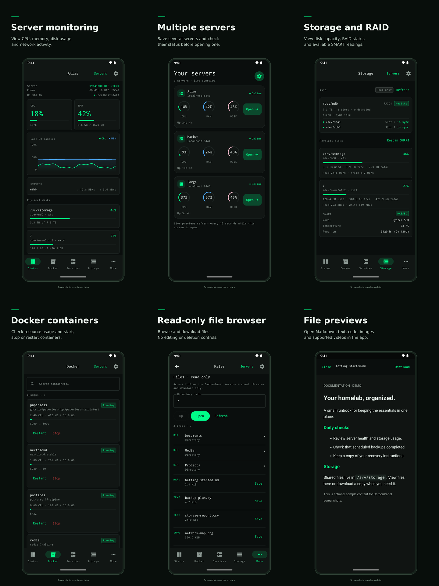

<p align="center"></p>

# CarbonPanel


<br/><br/>


A lightweight self-hosted server monitoring panel, No bs, No paywall.<br/>
Live CPU, RAM, GPU, disk, network, and process metrics over WebSocket, with service management, disk management, app/port scanning, JWT sessions, TOTP 2FA, and passkey authentication.


---

## Install

Installs as a native systemd or SysV service with nginx. Requires root, Ubuntu/Debian,
Python 3.11+, and a working Node.js 18+ build toolchain.

```bash
curl -fsSL https://carbonpanel.leodeng.dev/install.sh | sudo bash
```

Initial credentials are saved to `/opt/carbonpanel/shared/first-install.txt` after install.
First login walks you through an onboarding wizard to set a real password and optionally
enable 2FA.

> CarbonPanel manages the host it runs on — systemd services, real process/disk access,
> nginx sites — so the production path is the native installer. The
> retained `docker/` nginx snippets are legacy integration helpers only; they require an
> external TLS-terminating proxy and are not a standalone deployment.

nginx serves the panel over HTTPS with a self-signed certificate generated at install time
(covering the server's hostname and detected IPs). Your browser will warn that it isn't
trusted — that's expected for a self-signed cert; click through it (Chrome: "Advanced" →
"Proceed"). It's still real TLS encryption, just not backed by a public CA, which is a lot
better than the plaintext HTTP this used to default to.

Passkeys have stricter browser requirements than ordinary HTTPS. They are available only
when CarbonPanel is opened through a stable domain hostname and the certificate is trusted
by that device; clicking through the warning for an untrusted certificate is not enough.
Bare IP addresses are not valid WebAuthn relying-party IDs. TOTP remains available on every
deployment and is the fallback sign-in method when passkeys are unavailable.

---

## Updating

Use the **Settings → Install Update** button in the panel, or SSH in and run:

```bash
sudo carbonpanelctl update
```

The Web UI follows the specific update job it starts and displays server-reported
progress for each real phase (system packages, backend/frontend dependencies,
build, migration, deployment, and health check). Immediately before the backend
restarts, it shows a 60-second countdown and reloads automatically when the
restart window ends. Historical service logs are diagnostic only and never
advance the progress bar.

Update checks and installs are serialized so a timer cannot overwrite an
interactive result. Each manual check is matched to its own result instead of
reusing stale status. Updates auto-rollback on failed deployment or health check.
To roll back manually: `sudo carbonpanelctl rollback`.

---

## Configuration

Local development reads `backend/.env`; managed installs read
`/opt/carbonpanel/shared/backend.env`.

| Variable | Default | Description |
|---|---|---|
| `SECRET_KEY` | `dev-secret-...` | JWT signing key — **change this in production** |
| `ADMIN_USERNAME` | `admin` | Initial admin username |
| `ADMIN_PASSWORD` | `changeme` | Initial admin password; updates never reset an existing account |
| `APP_PORT` | `8787` | Port nginx listens on (HTTPS) |
| `COOKIE_SECURE` | `true` (install script) / `false` (local default) | Marks the session cookie HTTPS-only |
| `TLS_CERT_FILE` | unset (local) | PEM certificate whose SHA-256 fingerprint is embedded in Android pairing QR codes |
| `DATABASE_URL` | `sqlite+aiosqlite:///./carbonpanel.db` | Database connection string |
| `METRICS_INTERVAL_SECONDS` | `2.0` | How often metrics are collected |
| `PROCESS_LIMIT` | `25` | Max processes shown in the dashboard |

---

## Features

- Live **CPU, RAM, GPU, disk, network, and process** metrics over WebSocket
- **Disk management** — partition info, filesystem check, unmount (USB/removable only)
- **App/port scanner** — lists all listening ports with process info, custom labels, kill
- **System services** — browse, start/stop/restart, enable/disable, star and reorder
- **Sites** — manage tracked services with log streaming and config file editing
- **Customizable UI** — dark/light/auto theme, custom colors, fonts, gradients, background images
- **Secure authentication** — revocable JWT sessions, optional TOTP 2FA, and passwordless passkeys on trusted HTTPS hostnames
- **HTTPS by default** — self-signed cert generated at install time, no plaintext credentials on the wire
- **Guided onboarding** — first login walks through setting a password and 2FA setup
- **Native Android client** — HTTPS-only bearer auth; installer self-signed certificates are pinned from the pairing QR
- **In-panel updates** — version check via GitHub API, one-click update from the Settings page

---

## Android distribution and F-Droid preparation

GitHub remains the source repository and Android release location. Successful
Android releases also attach `carbonpanel-version.json`, which lets F-Droid's
update checks discover the published version and matching Git tag. Pushing a
commit to `master` does not publish an APK; the existing release-tag workflow applies.

F-Droid inclusion has been [submitted as a draft](https://gitlab.com/fdroid/fdroiddata/-/merge_requests/56044) and has **not been accepted**.
See the [submission draft](docs/fdroid-submission-draft.md) and
[build/update configuration](fdroid/README.md). The [v1.6.0 signed APK reproduced independently](docs/android-reproducibility.md);
F-Droid's own build and review remain pending.



[Full-size promotional images and screenshot reproduction](assets/store/README.md).

The launcher, web panel, and listing share the new
[Carbon C logo](assets/branding/README.md).

---

## Local Development

```bash
make setup   # generate secrets, install locked deps, migrate DB, seed admin
make dev     # run backend + frontend together
```

| URL | Service |
|---|---|
| `http://localhost:5173` | Frontend (Vite HMR) |
| `http://localhost:8010/api/v1` | Backend API |

`make dev` applies pending database migrations before starting both services and stops
their child processes when either service exits or you press Ctrl+C.

Other commands: `make backend`, `make frontend`, `make lint`

---

## Tech Stack

**Backend** — Python 3.11+, FastAPI, SQLAlchemy + Alembic, SQLite (aiosqlite), psutil

**Frontend** — Vue 3, TypeScript, Vite, Pinia, Chart.js

---

Idea and logic by @leodenglovescode, code assisted by AI

### NAS monitoring and older init systems

See [NAS compatibility and setup](docs/NAS.md) for Linux MD RAID, LVM, fan/PWM
monitoring, SysV service commands, and vendor-kernel limitations.

### Backgrounds and file previews

Settings → Backgrounds stores three independent destinations on the server:
web app, web login, and Android app. **Choose photo** opens one crop editor with
all three screens selected. Use one crop everywhere, or adjust separate web
and portrait phone crops, then save them together. The original photo is kept
on the server so **Adjust last uploaded photo** can recrop it without another
upload. Individual screen styles remain available under the advanced settings.
The Android server chooser uses a separate photo selected in the phone's
**App settings**. It stays in the phone's private storage, is never uploaded,
and is independent of every server. Pairing has no login background.
The **Surface transparency** slider under Appearance changes surface fills
while keeping text and icons opaque.

**Automatic placement** on the web dashboard groups CPU, memory, and GPU,
then system/cooling and storage/traffic cards, adapting to the actual content
width and browser zoom. Turn it off to restore your saved manual positions.
Editing switches to manual mode; neither mode overwrites the other’s positions.

**Files** in the web sidebar and Android's More menu provides read-only browsing,
previews, and downloads. It runs with the CarbonPanel service account's existing
filesystem permissions, without sudo or filesystem write operations. Regular
image, video, and audio formats preview where the client supports their codec;
Markdown renders with raw HTML and external images disabled, and code files
receive syntax highlighting. Text previews are capped at 1 MiB; larger files
can still be downloaded. Device, proc, and sys files are excluded. Directories
are paginated and limited to 10,000 entries per listing.

Installed panels require HTTPS for API and WebSocket traffic. The TLS nginx
listener redirects plain HTTP, and only the loopback proxy is trusted to report
the original protocol. The internal loopback readiness probe and local HTTP
development configuration remain available. Android continues to require HTTPS.
