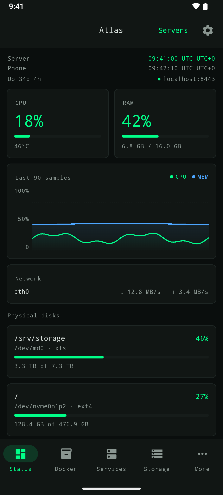
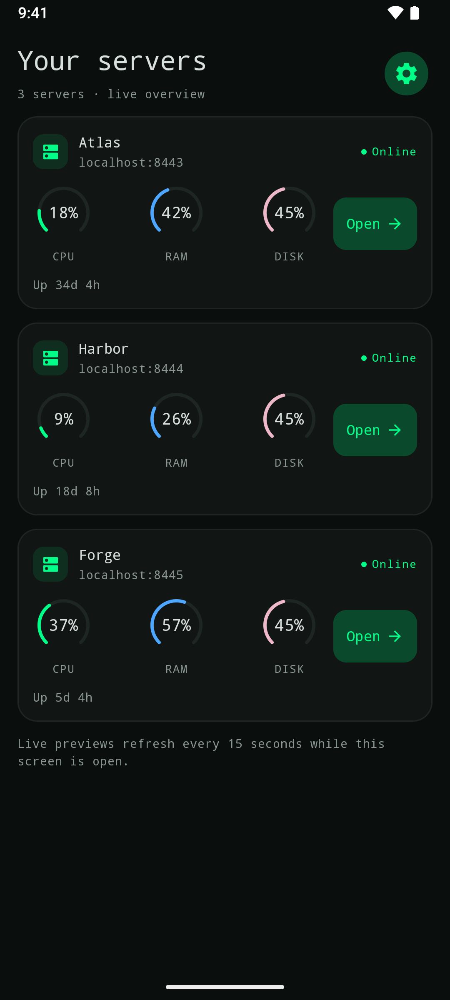
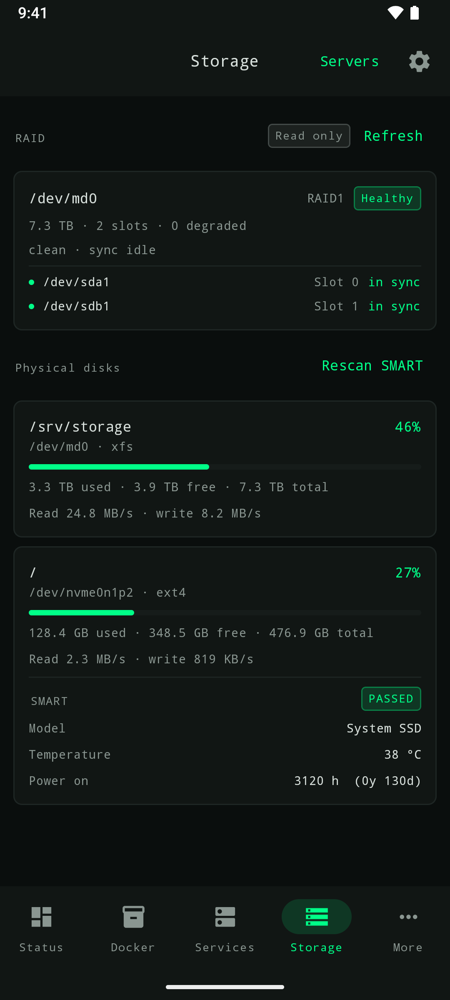

# CarbonPanel F-Droid submission

Draft merge request: https://gitlab.com/fdroid/fdroiddata/-/merge_requests/56044

Submitted from the plain `carbonpanel` branch of the public metadata fork.
The earlier draft was superseded when the submission branch was renamed.
For verification evidence see [Android reproducibility](android-reproducibility.md).

The text below records the submitted body.

## Abstract for new app inclusion

### Functions and usage

CarbonPanel (`dev.carbonpanel`) is a native Android client for the MIT-licensed,
self-hosted CarbonPanel Linux server/NAS panel. Pair through a QR code from the
web panel and connect over HTTPS, including pinned self-signed certificates.

The app shows CPU, memory, disks, network activity, processes, software RAID and
available SMART/temperature readings. It also provides Docker and system service
controls, saved servers, home-screen widgets, and a read-only file browser with
previews and downloads. A reachable CarbonPanel server is required; there is no
required proprietary hosted service or Google account.

Screenshots are real emulator captures with fictional data:

| Monitoring | Servers | Storage |
| --- | --- | --- |
|  |  |  |

### Purpose and scope

This companion provides phone access to the maintainer's self-hosted CarbonPanel
installation. It combines QR pairing and certificate pinning with monitoring,
container/service actions, and file access limited by the panel service account.
The native interface includes widgets and multiple saved servers. This describes
the integration it provides; it does not claim competing apps lack these features.

### Version and signing

- Version: 1.6.0 / 10600; source commit `552ba971d1988dde3dded060db09bc2c7a2afe95`.
- Source and listing assets remain on GitHub. This MR adds only the build recipe.
- Upstream-signed reproducible builds are selected: `Binaries` references the
  GitHub release APK and `AllowedAPKSigningKeys` pins the certificate already
  used for v1.5.0. Please do not substitute F-Droid signing if reproduction fails.
- The release workflow requires a clean unsigned rebuild, public signature copying,
  successful signature verification, and a byte-for-byte comparison before publication.
- The HTTP version feed is attached only to successful Android releases. Backend-only
  tags do not publish APKs. Automatic build generation supplies the new version's
  name/code through Gradle properties.

Published and independently reproduced APK SHA-256:
`61858870a1daf03fed1fe841d9b479ff0e5bab8c0f3273528f45b69467e90969`.
Certificate SHA-256:
`f06b0403ff6784ff9ec32e6d0f96468ed044795847b8f29a537a6e26c08b20fd`.
Both local builds and the GitHub workflow passed public signature copying; the
separate recipe rebuild used OpenJDK 21 while CI used Temurin 17. No private
release-signing files were accessed for verification.

### Development age — please keep in draft until November 8

Android development started on 2026-08-08. Three calendar months elapse on
2026-11-08. This draft does not claim an exception to Quality Control point 6;
please do not merge before that requirement is satisfied.

## Checklist

### Policy

- [ ] Full inclusion-policy review by F-Droid; age requirement reaches three months on 2026-11-08.
- [x] Submitted with the upstream maintainer's approval through their account.
- [x] Upstream includes en-US Fastlane summary, description, icon, screenshots and changelog.

### Documentation

- [x] Read CONTRIBUTING, the build templates, Build Metadata Reference, and Quick Start Guide.

### Merge request setup

- [x] One app only; title follows `New app: CarbonPanel` (draft prefix while pending review).
- [x] Public fork, dedicated unprotected branch; no commits to fork master.
- [x] Searched fdroiddata and RFP for CarbonPanel; no existing requests found.
- [x] Followed the contributor Git workflow; no unrelated changes included.

### Metadata

- [x] File is `metadata/dev.carbonpanel.yml`, valid YAML with LF endings.
- [x] Listing copy/artwork/changelog are upstream, not duplicated in this MR.
- [x] Tagged release, automatic updates, issue tracker, and public AuthorName handle.
- [x] Build commit is the full hash, only the latest release is listed; no disabled versions.
- [x] No external source repositories or srclibs are required.
- [x] Upstream-signature reproduction is required by Binaries and pinned signing certificate.
- [x] Single APK retained: bundled AndroidX native helpers occupy about 60 KB
  compressed in a 2.8 MB APK, so ABI splitting would save little space.

### Validation and pipeline

- [x] Local Android build and 26 unit tests passed; metadata parsing and lint passed.
- [x] GitHub release workflow passed its signed/unsigned clean rebuild comparison.
- [x] Independent clean source copies at different paths passed signature-copy verification
  with a test key, without task/build cache reuse or private release-key access.
- [x] Published CI-signed APK reproduced independently from the exact source
  with recipe cleanup; signature verifies and complete APK bytes match.
- [ ] F-Droid infrastructure build and upstream-signature verification.
- [ ] All fork/MR pipeline checks and warnings reviewed.

The dependency audit found no known proprietary SDK/tracker matches. Resolved
release module POMs declared Apache 2.0 or BSD-3-Clause. Google Play Services,
Firebase, ML Kit, Play Billing and Play Core were absent. This is screening
evidence, not a substitute for F-Droid's review.

The fork pipeline failed before any jobs started:
https://gitlab.com/leodenglovescode/fdroiddata/-/pipelines/3035304837
GitLab GraphQL reports: "The pipeline failed due to the user not being verified."
Per the submission template, please trigger CI on F-Droid runners. This is not a
recipe test failure; the infrastructure checks above remain unchecked.

Successful upstream release build, including its reproducibility gate:
https://github.com/leodenglovescode/CarbonPanel/actions/runs/42177389382
Release APK and version feed:
https://github.com/leodenglovescode/CarbonPanel/releases/tag/v1.6.0

/label ~"New App"
